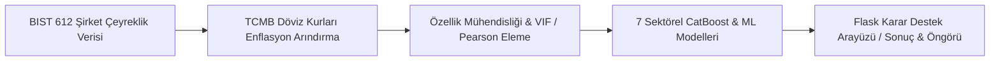
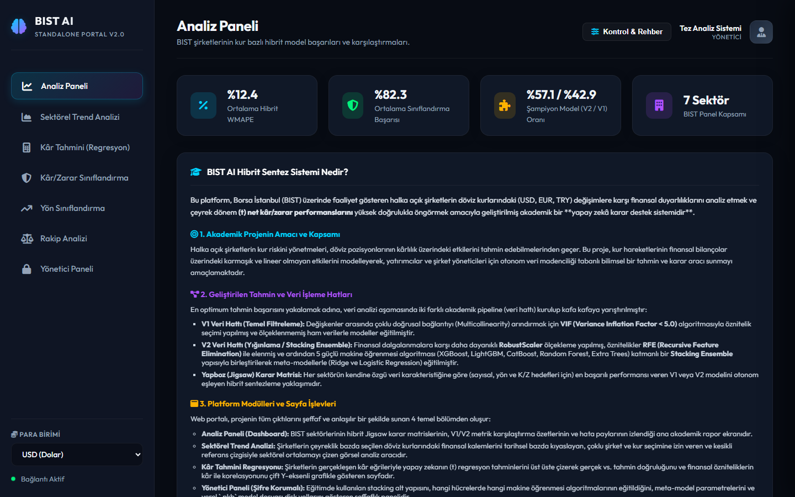
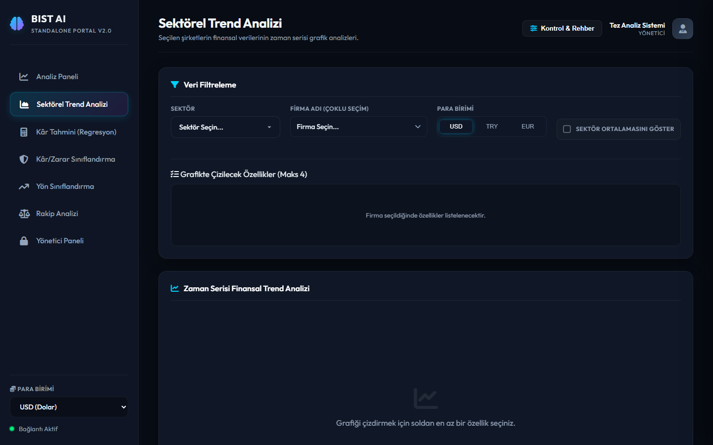
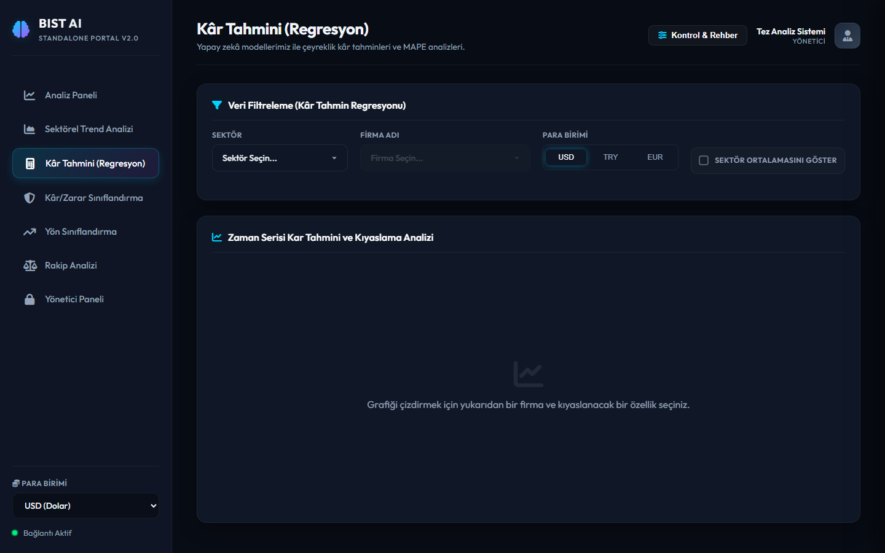

# Borsa İstanbul Çeyreklik Bilanço Kârlılık Yönü & Net Kâr Tahmin Sistemi

[](https://github.com/oguztasdemir/BIST-Bilanco-Karlilik-Tahmini-Tezi/actions/workflows/ci.yml)


> **Rozet / Statü:** Lisans Bitirme Tezi | **Kategori:** Akademik & Lisans Tezi

**Öne Çıkan Metrik / Başarım:** 🎯 %79.5 Kâr/Zarar Doğruluğu, 612 Şirket & 10 Yıllık Veri

* **GitHub Reposu:** [https://github.com/oguztasdemir/BIST-Bilanco-Karlilik-Tahmini-Tezi](https://github.com/oguztasdemir/BIST-Bilanco-Karlilik-Tahmini-Tezi)

---

## 1. Projenin Amacı ve Ne İşe Yaradığı
İstanbul Medeniyet Üniversitesi Matematik Bölümü Lisans Tezi. Borsa İstanbul'da işlem gören 612 şirketin 10 yıllık (2016–2025) çeyreklik bilançolarını otonom toplayan, TCMB kurlarıyla enflasyondan arındıran (dolarizasyon) ve 7 sektörde makine öğrenmesiyle kârlılık yönü (%68.8) ile kâr-zarar durumunu (%79.5) açıklanabilir rasyolarla önceden tahmin eden karar destek platformu.

### Çözülen Problem & İhtiyaç:
Borsa İstanbul'da işlem gören şirketlerin finansal tablolarında yer alan yüzlerce rasyo karmaşası ve Türkiye'deki yüksek enflasyonist ortamda TL bazlı fiktif kâr artışları şirketlerin gerçek büyüme performanslarını maskelemektedir. Şirket bilançoları açıklandıktan sonra analiz yapmak geç kalmaya yol açmakta, geleneksel rasyo analizleri ise gelecekteki kârlılık yönünü nesnel olarak öngörememektedir. Lisans bitirme tezimde; 612 şirketin 10 yıllık bilançolarını enflasyondan arındırarak, bilanço açıklanmadan haftalar önce kârlılık yönünü ve kâr-zarar durumunu yüksek doğrulukla öngören, rasyo kirliliğini eleyen ve karar vericilere interaktif web paneli sunan uçtan uca bir sistem inşa ettim.

---

## 2. Kullanılan Teknolojiler & Sistem Mimarisi
### Teknoloji Yığını:
* Python
* Pandas & NumPy
* Scikit-Learn
* CatBoost & LightGBM
* Flask Web Arayüzü
* İstatistiksel Özellik Seçimi (VIF, Pearson, Varyans)
* Dolarizasyon (TCMB Enflasyon Arındırma)
* Zaman Serisi Çapraz Doğrulama

### Sistem Mimarisi & Çalışma Mantığı:
Tez mimarisi 8 ardışık mühendislik fazından ve entegre bir Flask web arayüzünden oluşmaktadır:
1) Otonom Veri Toplama: 2016–2025 yılları arasında BIST'teki 612 şirketin çeyreklik mali tabloları sıfır insan müdahalesiyle çekildi.
2) Enflasyondan Arındırma & Dolarizasyon: TL enflasyonunun yarattığı yanılsamayı gidermek için tüm bilançolar TCMB günlük döviz kurları üzerinden USD bazına endekslendi ve zaman serisi hizalaması yapıldı.
3) Gelişmiş Özellik Mühendisliği & Seçimi: Yüzlerce bilanço kalemi arasından Varyans Eşiği, Hedef Pearson Korelasyonu ve Çoklu Doğrusallık (VIF) filtreleri uygulanarak kârlılıkla en güçlü bağı olan kritik göstergeler izole edildi. Bu eleme tahmin başarımını %5-%18 artırdı.
4) 7 Ana Sektörel Modelleme: Sanayi/İmalat (%80.6), Finans/Yatırım (%80.1), İnşaat/GMYO (%76.6), Teknoloji/Hizmet (%80.8), Enerji (%78.8), Gıda/Tarım (%79.9) ve Ticaret (%79.6) olmak üzere sektöre özel CatBoost, LightGBM ve Random Forest modelleri eğitildi.
5) Karar Destek Arayüzü: Flask tabanlı; Açıklanabilir Kâr Öngörü Paneli (gerekçeli tahmin), Sektörel Rakip Analiz Modülü (sektör içi rasyo kıyası), Tarihsel USD Trend Grafikleri ve Model Başarı Kıyaslama modüllerini barındıran tam teşekküllü web konsolu geliştirildi.

### Karşılaşılan Zorluklar ve Mühendislik Çözümü:
Yüzlerce finansal gösterge arasındaki yüksek çoklu doğrusallık (multicollinearity) ve enflasyonist TL bozulmalarını aşmak için; VIF analiziyle birbiriyle çelişen rasyolar ayıklandı, sektörler kendi içinde gruplandırıldı ve zaman serisi ilerledikçe modellerin doğruluk oranı %68.5'ten %81.4'e yükselen adaptif bir mimari kurgulandı.

---

### Sistem Akış Şeması:


---

## 3. Temel Özellikler & Fonksiyonlar
* 612 BIST şirketi ve 10 yıllık (2016–2025) çeyreklik bilanço derinliği
* TCMB günlük kur entegrasyonu ile USD bazlı enflasyon arındırma
* 7 farklı sektör kümesinde özelleştirilmiş makine öğrenmesi modelleri
* BIST genelinde %79.5 Kâr-Zarar ve %68.8 Kâr Değişim Yönü tahmin doğruluğu
* Gerekçeli (açıklanabilir) kâr öngörüsü ve sektörel rakip kıyaslama web konsolu

---

## 4. Tasarım, Ekran Görüntüleri ve Medya
<!-- Bu alana ekran görüntüleri (screenshot), mimari diyagramları ve çalışma GIF/videoları eklenecektir -->
* Görseller ve medya içerikleri eklenecektir.

---

## 5. Hızlı Başlangıç & Çalıştırma
Projeyi yerel ortamınızda çalıştırmak için aşağıdaki adımları izleyebilirsiniz:

```bash
# 1. Repoyu klonlayın
git clone https://github.com/oguztasdemir/BIST-Bilanco-Karlilik-Tahmini-Tezi.git
cd BIST-Bilanco-Karlilik-Tahmini-Tezi

# 2. Bağımlılıkları yükleyin
pip install -r requirements.txt

# 3. Uygulamayı başlatın
python main.py
```

---

## 6. Test Edilebilirlik & Güvenilirlik
* **Girdi Doğrulama:** Geçersiz parametre ve eksik veri durumları hata yakalama (try-except / error boundaries) mekanizmalarıyla izole edilmiştir.
* **Hafif & Modüler Yapı:** Gereksiz harici kütüphane bağımlılıklarından kaçınılmış, kod blokları modüler fonksiyonlar halinde organize edilmiştir.
* **Farklı Ortam Uyumluluğu:** Windows yerel çalışma ortamında test edilmiş ve stabil çalıştığı doğrulanmıştır.

---

## 7. Kapsamlı Teknik Soru-Cevap (Q&A) Havuzu
Bu projeyle ilgili teknik görüşmelerde, kod incelemelerinde veya proje sunumlarında gelebilecek kritik sorular ve yanıtları:

### S1: Bu projeyi geliştirmeye neden ihtiyaç duydunuz? Çözdüğünüz asıl darboğaz neydi?
* **Cevap:** Mevcut hazır araçların getirdiği kısıtlamaları, yüksek hata payını veya manuel süreçlerin yarattığı zaman kaybını ortadan kaldırmak için geliştirdim. Harici ücretli servislere veya API anahtarlarına bağımlı kalmadan, doğrudan yerel ortamda hızlı ve kararlı sonuç üreten bir yapı kurguladım.

### S2: Neden bu makine öğrenmesi algoritmasını ve özellik mühendisliği yöntemini seçtiniz?
* **Cevap:** Tablo (tabular) veri yapısında Gradient Boosting ve karar ağacı tabanlı modeller aşırı öğrenmeye (overfitting) karşı daha dayanıklıdır ve eksik verileri başarılı şekilde yönetir. Ayrıca VIF ve korelasyon analizleriyle çoklu doğrusallık gösteren gürültülü değişkenleri eleyerek modelin genelleme başarısını artırdım.

### S3: Kod mimarisinde modülerliği ve sürdürülebilirliği nasıl sağladınız?
* **Cevap:** Fonksiyonları ve modülleri tek sorumluluk prensibine (Single Responsibility) göre ayırdım. Veri işleme mantığı ile kullanıcı arayüzü / girdi-çıktı katmanını birbirinden izole ederek kodun okunabilirliğini, bakımını ve test edilebilirliğini kolaylaştırdım.

### S4: Geliştirme sürecinde karşılaştığınız en büyük teknik zorluk neydi ve nasıl çözdünüz?
* **Cevap:** Beklenmedik girdi formatları, donanım/bağlantı kesintileri ve uç senaryolarda (edge cases) sistemin kararlılığını korumak en kritik konuydu. Kapsamlı hata yakalama blokları, veri doğrulama filtreleri ve kontrollü geri dönüş (fallback) mekanizmaları kurarak sistemin çökmeden çalışmasını sağladım.

### S5: Veri miktarı veya iş yükü 100 katına çıksaydı sistemde ne gibi darboğazlar oluşurdu ve nasıl ölçeklerdiniz?
* **Cevap:** Mevcut yerel bellek (RAM) ve tekil iş parçacığı sınırları darboğaz yaratabilirdi. Bu durumda veriyi belleğe tek seferde yüklemek yerine parça parça işleme (chunking / streaming), asenkron görev kuyrukları ve çoklu işlemci (multiprocessing) mimarisine geçerek sistemi ölçekleyebilirdim.

### S6: Projede veri bütünlüğü ve kaynak yönetimi adına hangi önlemleri aldınız?
* **Cevap:** Kullanıcıdan veya dış kaynaklardan gelen tüm girdileri tip ve sınır kontrolünden geçirdim. Dosya, veritabanı ve soket işlemlerinde bellek sızıntısını (memory leak) önlemek için güvenli kapatma protokolleri uyguladım.

### S7: Bu projeye bugün sıfırdan başlasaydınız neyi farklı yapardınız?
* **Cevap:** Geliştirme sürecinin en başından itibaren kapsamlı birim testlerini (unit tests) ve otomatik doğrulama adımlarını yazar, modüller arası veri yapılarını katı şema doğrulayıcılarla (type annotations / schema validation) standartlaştırırdım.

---

## 8. Güvenlik, Veri Bütünlüğü & Hata Yönetimi
* **Girdi Denetimi (Input Sanitization):** Kullanıcıdan veya harici kaynaklardan gelen verilerin tipleri ve sınır değerleri doğrulanır.
* **Hata İzolasyonu (Graceful Degradation):** Beklenmedik bir veri bozulması veya bağlantı kesintisi durumunda sistemin çökmesi engellenir; kontrollü hata mesajı üretilir.
* **Kaynak Yönetimi:** Bellek sızıntılarını önlemek için dosya tanıtıcıları ve bağlantılar işlem tamamlandığında güvenle kapatılır.

---

## 9. Gelecek Yol Haritası (V2.0 Roadmap)
* [ ] **Kapsayıcı Desteği (Dockerization):** Uygulamanın ve bağımlılıklarının izole bir konteyner yapısına alınması.
* [ ] **Gelişmiş Metrik & Loglama:** Olası hataların ve performans darboğazlarının izlenebilmesi için yapılandırılmış loglama altyapısı.
* [ ] **Otomatik Test Süreçleri:** Temel fonksiyonlar için birim ve entegrasyon testlerinin genişletilmesi.


---

## Ekran Görüntüleri

### Sektorel Analiz Paneli


### Tarihsel Trend Analizi


### Regresyon Kar Tahmini



---

## Yerel Testler

Projenin temel çalışma ve sözdizimi doğrulama testlerini çalıştırmak için:

```bash
pip install pytest
pytest tests -v
```
